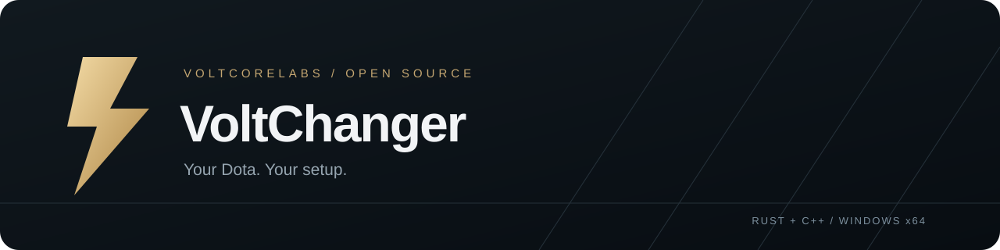

<p align="center"></p>

<p align="center">
  <a href="https://github.com/VoltCoreLabs/VoltChanger/releases"></a>
  <a href="LICENSE"></a>
  
  
</p>

<p align="center"><b>Косметика, сборки и статистика — в привычных экранах Dota 2.</b><br />Открытый проект VoltCoreLabs на Rust и C++.</p>

## Возможности

| | Что есть |
|---|---|
| **Лаунчер** | Светлый и тёмный glass-интерфейс на GPUI Kit, анимации, запуск Dota через Steam, подключение DLL и журнал состояния. |
| **Косметика** | Локальная экипировка предметов, личностей, стилей, курьеров, ландшафтов и эмблем своего героя. |
| **Сохранение** | Добавленные вещи, экипировка и настройки сохраняются с резервной копией. Автоматическая выдача всего каталога отключена. |
| **Обычная сетка героев** | Показатели WR/PR поверх исходных карточек; штатный поиск и категории сохраняются. |
| **Сборки в магазине** | Переключатель «Рекомендованные сборки»: DotaCoach, выбор позиции, предметы по этапам, способности и таланты. Выключение возвращает выбранный гайд. |
| **Прогресс героя** | Сохранённый визуальный уровень героя в меню и матче, локальные звук и текст реплик. |
| **Статистика** | Доступная история матчей, последние публичные игры участников, частые герои и предполагаемые линии. |

Сборки DotaCoach, переключение позиций и возврат обычного гайда проверены в игре.
Для позиций 4/5 источник предлагает общий гайд поддержки; проценты покупок не выдумываются.
Подробный статус функций и незавершённых сценариев — в [FUNCTIONS.md](FUNCTIONS.md).

## Быстрый старт

Нужны **Windows x64**, установленная Dota 2 и вход в Steam.
Скачайте архив из [последнего релиза](https://github.com/VoltCoreLabs/VoltChanger/releases/latest)
и распакуйте его целиком, затем откройте `start.cmd` или `VoltChanger.exe`.
При самостоятельной сборке по инструкции ниже используйте:

```text
dist/VoltChanger/start.cmd
```

Либо запустите **VoltChanger.exe** в этой папке и нажмите «Запустить Dota 2».
Скрипт запуска также доступен в корне проекта. Для обновления DLL завершите игру
и лаунчер, затем откройте новую сборку. В работающий процесс повторная копия не загружается.

Все переключатели перенесены в **«Настройки»** на главном экране. Там же находятся
выбор DLL, журнал и управление анимациями. Светлая/тёмная тема выбирается сверху
и сохраняется между запусками. «Рекомендованные сборки»
можно переключать без перезапуска уже загруженной новой версии модуля.

## Сборка

Установите Rust с MSVC toolchain, Visual Studio 2022/2026 с **Desktop development
with C++**, Windows SDK и компонентом CMake. Первая сборка скачивает зависимости.

```powershell
git clone https://github.com/VoltCoreLabs/VoltChanger.git
cd VoltChanger
powershell -NoProfile -ExecutionPolicy Bypass -File .\build.ps1
```

Готовое приложение: `dist/VoltChanger/VoltChanger.exe`.
Рядом находятся нативный модуль `ovr_skins.dll`, метаданные и скрипты запуска.
Зависимости Rust зафиксированы в `Cargo.lock`; Protobuf и ревизия протоколов тоже закреплены.

```powershell
cargo fmt --check
cargo clippy --locked --all-targets -- -D warnings
cargo test --locked
ctest --test-dir build/native -C Release --output-on-failure
```

Перед CTest нужно собрать цели `*_tests`; порядок описан в
[CONTRIBUTING.md](CONTRIBUTING.md). [Шаблон Windows CI](docs/ci-windows.yml)
включает Rust-проверки, нативную сборку и CTest. Для включения переместите его в
`.github/workflows/ci.yml` с учётной записью или токеном с правом `workflow`.

## Данные и ограничения

- Косметика и визуальный прогресс меняются локально. Проект не выдаёт вещи аккаунту и не оформляет Dota+.
- Серверные рекомендации Valve не эмулируются. Сборки приходят из [DotaCoach](https://dotacoach.gg/en/heroes), публичная статистика — из [OpenDota](https://docs.opendota.com/). Доступность зависит от источника и открытости профиля.
- Скрытая история профилей не раскрывается; наблюдения за объектами ограничены видимыми данными клиента.
- Для совместимости с прежними версиями настройки и инвентарь остаются в `%LOCALAPPDATA%\OVR`. Переименование приложения не сбрасывает экипировку.
- Репозиторий содержит исходники, тесты и нужные метаданные. Сборки, логи, дампы, личные настройки и игровой кэш исключены.

## Внутри проекта

```text
src/                  Rust / GPUI Kit launcher
upstream/src/         Native C++ module and preserved third-party notices
resources/assistant/  Identifier maps and runtime metadata
resources/launcher/   Original SVG artwork, embedded PNGs and Windows icon
proto/                Project protocol schema
vendor/protos/        Pinned upstream protocol definitions
scripts/              Build preparation and metadata generators
tests/                Native regression tests and factual fixtures
docs/                 Technical notes and repository artwork
```

[Технические заметки](docs/TECHNICAL.md) · [Статус функций](FUNCTIONS.md) ·
[Участие в разработке](CONTRIBUTING.md) · [Авторы и лицензии](NOTICE.md)

## Лицензия

**GPL-3.0-only.** Нативная основа — [pastow/ovr-skinchanger](https://github.com/pastow/ovr-skinchanger);
оригинальные уведомления об авторстве сохранены. Подробности — в [NOTICE.md](NOTICE.md).
VoltChanger — независимый проект, не связанный с Valve.
